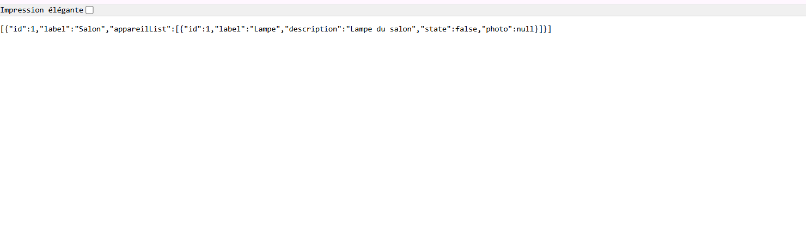
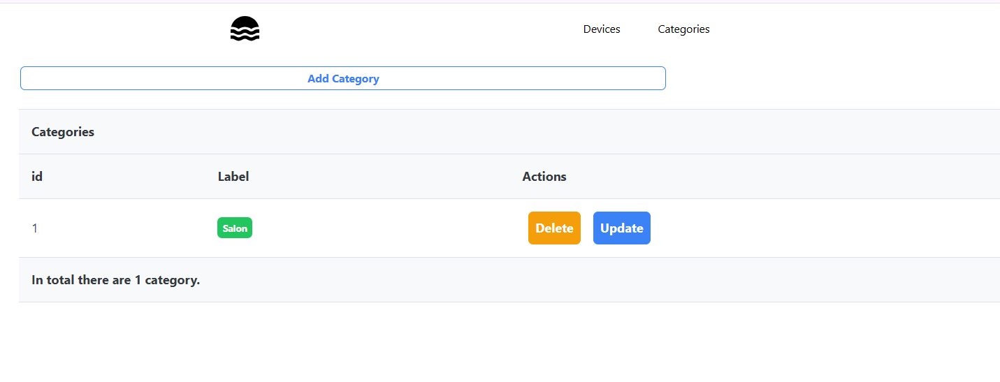
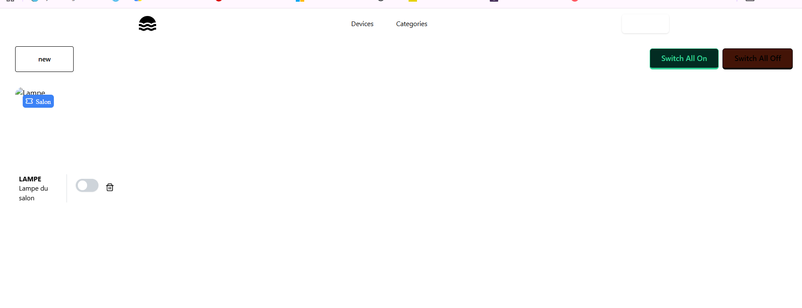
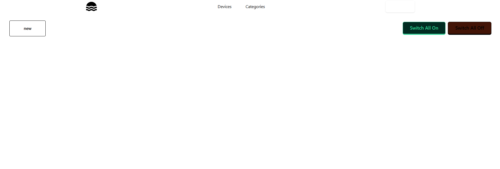

## Captures d'écran

### 1. API backend

Réponse JSON de l'API à l'adresse `http://localhost:8085/api/controller/categorie/`. On y voit la catégorie **Salon** (id 1) avec la liste de ses appareils, dont la **Lampe** (« Lampe du salon », état éteint). Cela prouve que le backend tourne dans Docker et lit correctement les données depuis MySQL.

### 2. Page des catégories

Page **Categories** du frontend. Le bouton **Add Category** permet d'ajouter une catégorie, et le tableau liste les catégories existantes avec les actions **Delete** et **Update**. Ici, la catégorie **Salon** a été créée.

### 3. Page des appareils

Page **Devices** après l'ajout d'un appareil. La **Lampe** apparaît avec sa catégorie **Salon**, sa description, un interrupteur pour l'allumer ou l'éteindre et une icône pour la supprimer. Les boutons **Switch All On** et **Switch All Off** allument ou éteignent tous les appareils d'un coup.

### 4. Page d'accueil du frontend

Page d'accueil de l'application au premier lancement, avant l'ajout de données. On y trouve la barre de navigation (**Devices**, **Categories**), le bouton **new** pour créer un appareil et les boutons **Switch All On** / **Switch All Off**. Cela confirme que le conteneur Nginx sert bien l'application Angular.